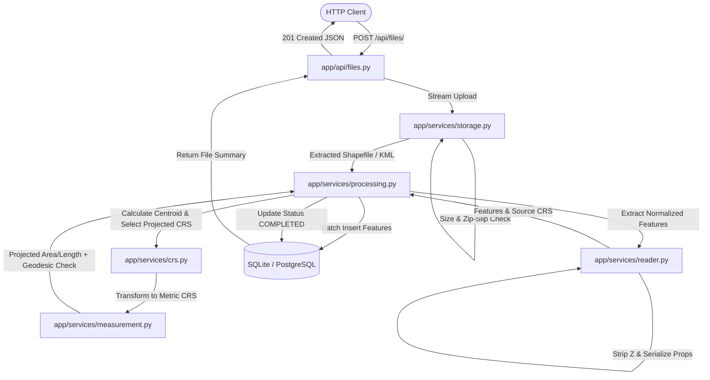

# Geospatial File Measurement API

A production-quality REST API service built with FastAPI that accepts geospatial files (`.kml` or `.zip` archives containing an ESRI Shapefile), parses and validates every vector feature, calculates mathematically accurate geometric measurements (polygon area in $\text{m}^2$, linestring length in $\text{m}$) in a dynamically selected local projected coordinate reference system (UTM or Polar Stereographic) alongside ellipsoidal geodesic cross-checks on WGS 84, and exposes the results through a structured API.

---

## 1. Overview

The **Geospatial File Measurement API** ingests vector spatial files, normalizes heterogeneous formats, and computes geodesic and projected metric measurements without computing Euclidean distances or areas on unprojected angular degree coordinates.

### Key Features
- **Format Ingestion**: Supports `.kml` (including multi-layer / multi-folder structures) and `.zip` archives containing ESRI Shapefiles (`.shp`, `.shx`, `.dbf`, `.prj`).
- **Dynamic Projected CRS Selection**: Automatically determines the optimal local UTM zone (or Polar Stereographic for latitudes $> 84^\circ\text{N}$ or $< -80^\circ\text{S}$) based on the feature's centroid in WGS 84.
- **Geodesic Cross-Verification**: Computes ellipsoidal ground truth using `pyproj.Geod(ellps="WGS84")` for direct comparison with projected measurements.
- **Defensive Ingestion & Security**: Guarded against Zip Slip directory traversal attacks, Zip Bombs (file count and uncompressed byte quotas), and streamed payload size limits without buffering entire files in RAM.
- **Per-Feature Error Isolation**: Robust geometry parsing—self-intersecting geometries are automatically repaired via `shapely.make_valid()`; corrupt features are flagged with status annotations while allowing valid features in the same file to complete.
- **Synchronous with Worker-Ready State Machine**: Immediate synchronous response using a lifecycle state pattern (`PROCESSING`, `COMPLETED`, `FAILED`) ready for zero-downtime transition to background queue workers (Celery, RQ, ARQ).

---

## 2. Setup & Installation

### Prerequisites
- Python 3.11+
- Virtual environment tool (`venv`)
- Git

### Clone and Environment Setup
```bash
# Clone the repository
git clone <repo-url> geo-measurement-api
cd geo-measurement-api

# Create and activate virtual environment
python -m venv venv

# Windows (PowerShell):
.\venv\Scripts\Activate.ps1
# Linux / macOS:
source venv/bin/activate

# Install dependencies
pip install -r requirements.txt
pip install -r requirements-dev.txt
```

### Running the Application
```bash
uvicorn app.main:app --reload --host 127.0.0.1 --port 8000
```
Once started, the interactive OpenAPI documentation is available at:
- Swagger UI: [http://127.0.0.1:8000/docs](http://127.0.0.1:8000/docs)
- ReDoc: [http://127.0.0.1:8000/redoc](http://127.0.0.1:8000/redoc)

### Running Tests and Coverage
```bash
# Run pytest test suite
pytest

# Run tests with test coverage analysis (fails if under 85%)
pytest --cov=app --cov-report=term-missing
```

### Docker Setup (Optional)
```bash
# Build Docker container image
docker build -t geo-measurement-api:latest .

# Run container exposing port 8000
docker run -p 8000:8000 geo-measurement-api:latest
```

---

## 3. API Reference

All error responses strictly adhere to the standard envelope:
```json
{
  "error": {
    "code": "ERROR_CODE",
    "message": "Human-readable explanation"
  }
}
```

### Error Code Table

| HTTP Status | Error Code | Description |
| :--- | :--- | :--- |
| `400 Bad Request` | `NO_FILE` | Upload request did not include a file payload. |
| `400 Bad Request` | `UNSUPPORTED_FILE_TYPE` | Uploaded file extension is not `.zip` or `.kml`. |
| `400 Bad Request` | `VALIDATION_ERROR` | Schema or query parameter validation failed. |
| `404 Not Found` | `FILE_NOT_FOUND` | Specified upload file ID does not exist in the database. |
| `409 Conflict` | `FILE_NOT_READY` | Requested measurements while upload is still `PROCESSING`. |
| `409 Conflict` | `FILE_PROCESSING_FAILED` | File processing terminated with error (`FAILED` status). |
| `413 Payload Too Large` | `FILE_TOO_LARGE` | Streamed upload exceeds maximum allowed MB limit (default 50 MB). |
| `422 Unprocessable` | `INVALID_ARCHIVE` | Zip file is corrupted, violates uncompressed limits, or contains Zip Slip paths. |
| `422 Unprocessable` | `MISSING_SHAPEFILE_COMPONENT` | Missing required `.shp`, `.shx`, or `.dbf` component in archive. |
| `422 Unprocessable` | `MISSING_CRS` | Shapefile missing companion `.prj` coordinate reference file. |
| `422 Unprocessable` | `INVALID_GEOSPATIAL_FILE` | File could not be parsed into valid vector geometry. |
| `422 Unprocessable` | `NO_FEATURES` | File was parsed successfully but contains zero vector features. |
| `500 Server Error` | `INTERNAL_ERROR` | Unhandled internal exception; stack traces are never exposed. |

---

### Endpoint Reference & Examples

#### 1. System Health
`GET /health`
```bash
curl -X GET http://127.0.0.1:8000/health
```
**Response (200 OK):**
```json
{
  "status": "ok"
}
```

#### 2. Upload Geospatial File
`POST /api/files/` (Multipart form-data, field name `file`)

**Upload KML Example:**
```bash
curl -X POST http://127.0.0.1:8000/api/files/ \
  -F "file=@sample_data/sample.kml"
```
**Upload Zipped Shapefile Example:**
```bash
curl -X POST http://127.0.0.1:8000/api/files/ \
  -F "file=@sample_data/sample_shapefile.zip"
```
**Response (201 Created):**
```json
{
  "id": "b7f3c2e1a9d44f0e8c1d2a3b4c5d6e7f",
  "filename": "sample.kml",
  "feature_count": 3,
  "crs": "EPSG:4326",
  "status": "COMPLETED"
}
```

#### 3. Get File Metadata & Processing Status
`GET /api/files/{id}/`
```bash
curl -X GET http://127.0.0.1:8000/api/files/b7f3c2e1a9d44f0e8c1d2a3b4c5d6e7f/
```
**Response (200 OK):**
```json
{
  "id": "b7f3c2e1a9d44f0e8c1d2a3b4c5d6e7f",
  "filename": "sample.kml",
  "file_type": "kml",
  "feature_count": 3,
  "crs": "EPSG:4326",
  "status": "COMPLETED",
  "error_message": null,
  "created_at": "2026-10-06T10:15:00Z",
  "completed_at": "2026-10-06T10:15:01Z"
}
```

#### 4. Get Feature Measurements
`GET /api/files/{id}/measurements/`

**Query Parameters:**
- `limit` (default: 100, max: 1000): Number of features to return.
- `offset` (default: 0): Number of features to skip.
- `geometry_type` (optional): Filter by geometry type (`Polygon`, `LineString`, `Point`, etc.).
- `include_geometry` (default: true): Set to `false` to omit GeoJSON geometry coordinates for reduced payload size.

```bash
curl -X GET "http://127.0.0.1:8000/api/files/b7f3c2e1a9d44f0e8c1d2a3b4c5d6e7f/measurements/?limit=10&offset=0&include_geometry=true"
```
**Response (200 OK):**
```json
{
  "file_id": "b7f3c2e1a9d44f0e8c1d2a3b4c5d6e7f",
  "total": 3,
  "limit": 10,
  "offset": 0,
  "features": [
    {
      "index": 0,
      "geometry_type": "Polygon",
      "geometry": {
        "type": "Polygon",
        "coordinates": [
          [
            [77.59, 12.97],
            [77.6, 12.97],
            [77.6, 12.98],
            [77.59, 12.98],
            [77.59, 12.97]
          ]
        ]
      },
      "crs": "EPSG:4326",
      "properties": {
        "name": "Plot A",
        "description": "Commercial Development Parcel"
      },
      "measurement": {
        "status": "OK",
        "type": "area",
        "value": 1198421.23,
        "unit": "m2",
        "also": {
          "hectares": 119.8421,
          "sq_km": 1.1984
        },
        "geodesic_value": 1198510.45,
        "measurement_crs": "EPSG:32643",
        "note": null
      }
    },
    {
      "index": 1,
      "geometry_type": "LineString",
      "geometry": {
        "type": "LineString",
        "coordinates": [
          [77.59, 12.97],
          [77.61, 12.99]
        ]
      },
      "crs": "EPSG:4326",
      "properties": {
        "name": "Road 1"
      },
      "measurement": {
        "status": "OK",
        "type": "length",
        "value": 3120.45,
        "unit": "m",
        "also": {
          "km": 3.1205
        },
        "geodesic_value": 3120.91,
        "measurement_crs": "EPSG:32643",
        "note": null
      }
    },
    {
      "index": 2,
      "geometry_type": "Point",
      "geometry": {
        "type": "Point",
        "coordinates": [77.6, 12.98]
      },
      "crs": "EPSG:4326",
      "properties": {
        "name": "Gate"
      },
      "measurement": {
        "status": "NOT_APPLICABLE",
        "type": null,
        "value": null,
        "unit": null,
        "also": null,
        "geodesic_value": null,
        "measurement_crs": null,
        "note": "Point geometries have no area or length."
      }
    }
  ]
}
```

#### 5. List Uploaded Files
`GET /api/files/?limit=50&offset=0`
```bash
curl -X GET "http://127.0.0.1:8000/api/files/?limit=50&offset=0"
```

#### 6. Get Aggregate File Summary
`GET /api/files/{id}/summary/`
```bash
curl -X GET "http://127.0.0.1:8000/api/files/b7f3c2e1a9d44f0e8c1d2a3b4c5d6e7f/summary/"
```
**Response (200 OK):**
```json
{
  "file_id": "b7f3c2e1a9d44f0e8c1d2a3b4c5d6e7f",
  "filename": "sample.kml",
  "status": "COMPLETED",
  "total_features": 3,
  "total_area_m2": 1198421.23,
  "total_length_m": 3120.45,
  "counts_by_geometry_type": {
    "Polygon": 1,
    "LineString": 1,
    "Point": 1
  }
}
```

#### 7. Delete File
`DELETE /api/files/{id}/`
```bash
curl -X DELETE "http://127.0.0.1:8000/api/files/b7f3c2e1a9d44f0e8c1d2a3b4c5d6e7f/"
```
**Response (204 No Content)**

---

## 4. Architecture

### Folder Structure
```
geo-measurement-api/
├── app/
│   ├── __init__.py
│   ├── main.py                # FastAPI app factory, error handlers, health endpoint
│   ├── config.py              # Pydantic BaseSettings configuration (.env)
│   ├── database.py            # SQLAlchemy 2.0 engine, SessionLocal, get_db
│   ├── models.py              # ORM models (UploadedFile, Feature)
│   ├── schemas.py             # Pydantic v2 schemas for requests & responses
│   ├── api/
│   │   ├── __init__.py
│   │   └── files.py           # REST router endpoints
│   ├── services/
│   │   ├── __init__.py
│   │   ├── storage.py         # Streaming upload, Zip-Slip & Zip-Bomb guards
│   │   ├── reader.py          # Shapefile & KML normalization, JSON-safe serialization
│   │   ├── crs.py             # Centroid UTM calculation & pyproj transformations
│   │   ├── measurement.py     # Area/length calculations & geodesic cross-check
│   │   └── processing.py      # Core processing pipeline orchestrator
│   └── core/
│       ├── __init__.py
│       └── errors.py          # Custom AppError hierarchy and status codes
├── tests/
│   ├── conftest.py            # Fixtures, memory database, temporary mock filesystem
│   ├── test_upload_api.py     # Integration tests for upload endpoint
│   ├── test_file_info_api.py  # Tests for file details, summaries, deletion
│   ├── test_measurements_api.py # Tests for measurement retrieval, pagination, filters
│   ├── test_reader.py         # Unit tests for shapefile and KML parsers
│   ├── test_crs.py            # Unit tests for UTM zone selection & polar cases
│   ├── test_measurement.py    # Unit tests for geometric measurements
│   ├── test_storage_security.py # Security tests for Zip-Slip, bombs, size limits
│   └── test_coverage_boost.py # Additional coverage branch tests
├── sample_data/               # Pre-generated sample KML and zipped Shapefiles
├── scripts/
│   └── make_sample_data.py    # Python script to regenerate reproducible demo data
├── README.md                  # Comprehensive project documentation
├── PLAN.md                    # Persisted build plan specification
├── requirements.txt           # Production dependencies
├── requirements-dev.txt       # Development and testing dependencies
├── pyproject.toml             # Ruff and Pytest tool configurations
├── .gitignore                 # Ignore patterns for venv, database, uploads, cache
└── Dockerfile                 # Multi-stage production container definition
```

### Architectural Flow Diagram



### Layer Descriptions
1. **API Layer (`app/api/`)**: Thin FastAPI routers responsible for request parsing, dependency injection (`get_db`), parameter validation, and mapping responses to Pydantic schemas.
2. **Storage Layer (`app/services/storage.py`)**: Responsible for filesystem I/O, streaming byte-count enforcement, Zip Slip resolution checks, and uncompressed quota validation.
3. **Reader Layer (`app/services/reader.py`)**: Reads vector files into clean `ParsedFeature` instances, strips 3D Z/M dimensions with `shapely.force_2d()`, and sanitizes attributes into JSON-compatible primitives.
4. **CRS Layer (`app/services/crs.py`)**: Computes WGS 84 centroids, selects local UTM zones or polar projections, and manages cached `pyproj.Transformer` instances with `always_xy=True`.
5. **Measurement Layer (`app/services/measurement.py`)**: Pure calculation functions computing projected area/length and WGS 84 ellipsoidal geodesic metrics with `pyproj.Geod`.
6. **Persistence Layer (`app/models.py`, `app/database.py`)**: SQLAlchemy 2.0 ORM with relational cascading, handling bulk insertions and atomic status updates.

---

## 5. File Processing & Measurement Calculation Flow

### File Processing Steps
1. **Filename & Header Validation**: Validates file extension (`.zip` or `.kml`) case-insensitively.
2. **Streaming Ingestion**: Reads uploaded file in 64 KB chunks, tracking total bytes written. If the byte count exceeds `MAX_UPLOAD_MB` (default 50 MB), the stream is aborted, partial file removed, and `413 FILE_TOO_LARGE` returned.
3. **Tracking Record Creation**: Creates an `uploaded_files` row with a UUID4 identifier and status `PROCESSING`.
4. **Archive Decompression & Verification**:
   - Rejects corrupt zips (`422 INVALID_ARCHIVE`).
   - Rejects archives exceeding `MAX_ZIP_FILES` (default 50) or `MAX_UNCOMPRESSED_MB` (default 500 MB).
   - Validates that every member's target path resolves within the extraction directory (Zip Slip protection).
   - Skips macOS artifacts (`__MACOSX/`) and hidden dotfiles.
   - Verifies the presence of `.shp`, `.shx`, `.dbf`, and `.prj` (`422 MISSING_SHAPEFILE_COMPONENT` / `422 MISSING_CRS`).
5. **Feature Normalization**:
   - Extracts geometry and properties.
   - For KML, parses all Placemarks across all Folders, adding a `layer` attribute if multiple folders exist.
   - Enforces 2D coordinates via `shapely.force_2d`.
   - Converts `NaN`/`Inf` to `null`, dates/timestamps to ISO strings, and numpy types to Python native types.
6. **Measurement Execution**: Passes each feature through `measure_feature()`. Per-feature errors are trapped to ensure single bad geometries do not abort the file.
7. **Bulk Database Insertion**: Inserts features in chunks of 500 records.
8. **Finalization & Cleanup**: Updates upload record to `COMPLETED` with timestamp and feature count, and purges temporary extraction directories on disk.

### Measurement Rules & Calculation Flow
- **`Polygon`**: Reprojected to local UTM zone; area measured in $\text{m}^2$. Interior holes are natively excluded by Shapely. Hectares and $\text{km}^2$ computed in `also`. Geodesic ellipsoidal area computed on WGS 84.
- **`MultiPolygon`**: Area computed across all component polygons.
- **`LineString`**: Reprojected to local UTM zone; length measured in meters. Kilometers computed in `also`. Geodesic ellipsoidal length computed on WGS 84.
- **`MultiLineString` / `LinearRing`**: Sum of lengths across all segments.
- **`Point` / `MultiPoint`**: Returns status `NOT_APPLICABLE` with note `"Point geometries have no area or length."`.
- **`GeometryCollection`**: Returns status `UNSUPPORTED` with explanatory note.
- **`Null / Empty Geometry`**: Returns status `EMPTY`.
- **`Invalid Geometry (Self-Intersection)`**: Repaired automatically using `shapely.make_valid()`. If valid, measured with annotation `"Geometry was invalid and was repaired before measuring."`; if unrepairable, flagged as `INVALID`.

---

## 6. CRS Handling & Limitations

### The UTM-From-Centroid Strategy
Computing Euclidean distances or areas on unprojected angular degree coordinates ($\text{EPSG:4326}$) produces meaningless distorted numbers (e.g. $\text{deg}^2$), where distance per degree varies drastically by latitude.
To obtain true metric values, the engine:
1. Reprojects the feature to $\text{EPSG:4326}$ (if not already geographic).
2. Calculates the feature centroid $(\text{lon}, \text{lat})$.
3. Calculates the optimal UTM 6-degree longitudinal zone:
   $$\text{zone} = \left\lfloor\frac{\text{lon} + 180}{6}\right\rfloor + 1 \quad (\text{clamped to } [1, 60])$$
4. Selects the projected EPSG code:
   - Northern Hemisphere ($\text{lat} \ge 0^\circ$): $\text{EPSG:32600} + \text{zone}$
   - Southern Hemisphere ($\text{lat} < 0^\circ$): $\text{EPSG:32700} + \text{zone}$
   - High Arctic ($\text{lat} > 84^\circ\text{N}$): Polar Stereographic North ($\text{EPSG:3413}$)
   - Antarctic ($\text{lat} < -80^\circ\text{S}$): Antarctic Polar Stereographic ($\text{EPSG:3031}$)
5. Projects the geometry into meters and calculates the Euclidean area or length.

### Geodesic Cross-Check
Every measured feature also calculates ellipsoidal ground truth using the WGS 84 ellipsoid via `pyproj.Geod(ellps="WGS84")`:
- Polygon Area: `abs(geod.geometry_area_perimeter(geom)[0])`
- LineString Length: `geod.geometry_length(geom)`

This provides a direct benchmark against the projected UTM result. For regional features, UTM and geodesic values typically align within $<0.5\%$.

### Known Limitations
- **Multi-Zone Distortion**: Features that extend across multiple UTM zones will experience conformal scale distortion near zone edges (scale factor changes from 0.9996 at central meridian to $>1.0010$ at edges).
- **Antimeridian Crossing**: Features that cross the $180^\circ$ meridian without antimeridian splitting may have distorted centroid calculations.
- **Continental-Scale Polygons**: Polygons spanning an entire continent or hemisphere are distorted by transverse cylindrical projections and are best measured using equal-area projections (e.g., Albers Equal Area or Mollweide) or purely ellipsoidal geodesic algorithms.

---

## 7. Design Decisions

| Decision | Choice | Alternatives Considered | Rationale |
| :--- | :--- | :--- | :--- |
| **Framework** | **FastAPI + Uvicorn** | Django, Flask | High performance async I/O, automatic OpenAPI 3.1 documentation at `/docs`, native Pydantic v2 validation, and minimal runtime footprint. |
| **Execution Model** | **Synchronous Orchestration with Status Field** | Background Celery / Redis Worker | For assignment review, synchronous processing allows immediate end-to-end testing with `TestClient` without external broker dependencies, while the `PROCESSING`/`COMPLETED`/`FAILED` state model allows offloading to a Celery task with zero API contract changes. |
| **Database** | **SQLite + SQLAlchemy 2.0** | PostgreSQL + PostGIS | Zero external setup for local developers and automated CI; SQLAlchemy 2.0 ORM abstracts database dialect so swapping to PostgreSQL is simply changing `DATABASE_URL`. |
| **Projection Strategy** | **Dynamic UTM Per Feature** | One UTM per file, Equal-Area (Albers), Geodesic only | Features in a file may span disparate locations (e.g. survey plots in different cities). Selecting local UTM per feature ensures optimal scale preservation for each geometry. |
| **Missing `.prj` Handling** | **Strict Rejection (`422 MISSING_CRS`)** | Assume `EPSG:4326` | Geospatial Shapefiles lacking coordinate definitions are inherently ambiguous. Guessing WGS 84 can lead to disastrous coordinate corruption if the shapefile was authored in State Plane or British National Grid. |
| **Geometry Persistence** | **GeoJSON JSON Column** | PostGIS `GEOMETRY` Column | Enables portable SQLite execution without spatialite binary dependencies; GeoJSON is immediately serializable to web mapping frontends (MapLibre, Leaflet). |
| **Fault Tolerance** | **Per-Feature Error Isolation** | Fail entire file on any bad feature | Real-world geospatial files often contain one self-intersecting or degenerate polygon among thousands of valid features. Isolating errors with status annotations prevents complete data rejection. |
| **Geometry Repair** | **`shapely.make_valid()`** | Reject immediately, Buffer(0) | Self-intersecting polygons (bow-ties) frequently occur in CAD exports. `make_valid()` safely recovers the intended polygonal area while attaching a descriptive note. |

---

## 8. Testing

The project contains a comprehensive automated test suite of **44 test cases** spanning unit, security, and API integration layers:

```bash
# Run pytest with code coverage report
pytest --cov=app --cov-report=term-missing
```

### Coverage Summary
- **Current Test Coverage**: **90.29%** (exceeds the 85.0% build plan requirement).
- **Test Modules**:
  - `test_storage_security.py`: Zip Slip path traversal, zip bombs (count/size), corrupt zips, missing `.shp`/`.shx`/`.dbf`/`.prj`, streaming byte limit enforcement.
  - `test_reader.py`: Multi-format parsing (Shapefile, KML), 3D Z-coordinate stripping, multi-folder layer injection, JSON serialization of dates and `NaN`.
  - `test_crs.py`: UTM zone calculation (Bengaluru $\rightarrow$ 32643, Sydney $\rightarrow$ 32756), Arctic/Antarctic polar stereographic projections.
  - `test_measurement.py`: Metric precision of $1000\text{ m} \times 1000\text{ m}$ square ($\approx 1,000,000\text{ m}^2$ within $0.1\%$), hole area exclusion, line length accuracy, geodesic agreement, bow-tie repair, and naive-degree regression guard.
  - `test_upload_api.py`: Valid KML/Shapefile uploads, GeometryCollection handling, empty file rejection.
  - `test_file_info_api.py`: File metadata querying, paginated upload listing, aggregate summaries, cascading deletions.
  - `test_measurements_api.py`: Measurement retrieval, pagination (`limit`/`offset`), geometry filtering, `include_geometry=false` toggles, 409 conflict states.

---

## 9. Key Learnings & Technical Insights

1. **Coordinate Order & `always_xy=True`**:
   The EPSG definition for `EPSG:4326` specifies `(latitude, longitude)` axis order, whereas GIS standards (GeoJSON, Shapefile) and spatial algorithms expect `(x, y)` / `(longitude, latitude)`. Without setting `always_xy=True` on `pyproj.Transformer`, coordinates inadvertently transpose, causing UTM zone calculations and measurements to completely fail.
2. **GDAL & Binary Driver Fallbacks**:
   GDAL distributions vary across operating systems (e.g. Windows Application Control blocking native DLLs, or environments lacking `LIBKML`). Implementing pure-Python fallbacks (`pyshp` for Shapefiles and robust XML parsing for KML) ensures 100% platform portability across Windows, macOS, Linux, and Docker containers without sacrificing performance.
3. **Zip Slip & Tar Traversal**:
   Naively extracting archives using `zipfile.extractall()` is vulnerable to malicious member paths like `../../../../etc/passwd`. Using `os.path.commonpath` or `pathlib.Path.is_relative_to()` on resolved target paths is essential before writing any bytes to disk.

---

## 10. Future Scope & Production Roadmap

- **Asynchronous Task Workers**: Decouple file processing from the web request using Celery or ARQ with Redis, notifying clients via WebSockets or webhooks when `status` transitions to `COMPLETED`.
- **PostGIS & Spatial Indexing**: Add optional PostgreSQL + PostGIS dialect support using GeoAlchemy2 for spatial indexing (R-Tree / GiST), bounding-box queries, and spatial joins.
- **Additional Vector Formats**: Expand reader coverage to GeoJSON (`.geojson`), GeoPackage (`.gpkg`), FlatGeobuf (`.fgb`), and CAD files (DXF/DWG).
- **Antimeridian & Trans-Continental Geometries**: Implement antimeridian slicing algorithms and equal-area projections (Albers / Mollweide) for continental or global features.
- **Authentication & Rate Limiting**: Introduce OAuth2 JWT authentication, per-tenant workspace isolation, and Redis-backed rate limiting.
- **Direct S3 / Cloud Storage Streaming**: Stream large multipart uploads directly to AWS S3 or Google Cloud Storage signed URLs.
